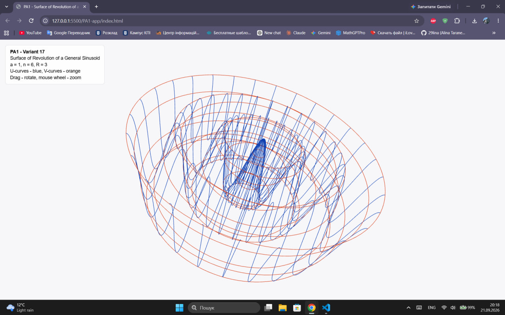

# PA1 — Surface Rendering

## Variant

17 — Surface of Revolution of a General Sinusoid

## Analytical surface

The surface is defined parametrically as:

x(u, v) = u cos(v)

y(u, v) = u sin(v)

z(u, v) = a cos(nπu / R)

where:

- u = r
- v = β
- 0 <= u <= R
- 0 <= v <= 2π

Parameters used in the implementation:

- a = 1
- n = 6
- R = 3

## Wireframe

The wireframe consists of two families of polylines:

- U-curves: v is constant and u changes
- V-curves: u is constant and v changes

The vertices of the two curve families are stored separately
in Float32Array objects and uploaded to separate WebGL buffers.

Each polyline is rendered using:

gl.drawArrays(gl.LINE_STRIP, first, count)

## Controls

- Mouse drag — rotate the surface
- Mouse wheel — zoom

## Screenshot

## Video

2-minute explanation of the U/V vertex data structure:

https://drive.google.com/file/d/1LYU_gX8b2uVs1cTEB_9fw_206t5ptZd4/view?usp=sharing